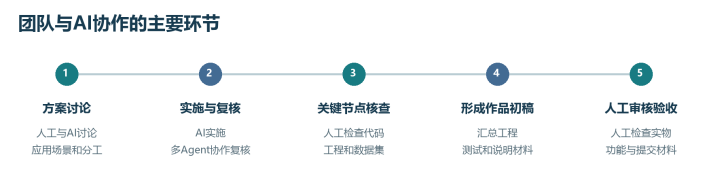
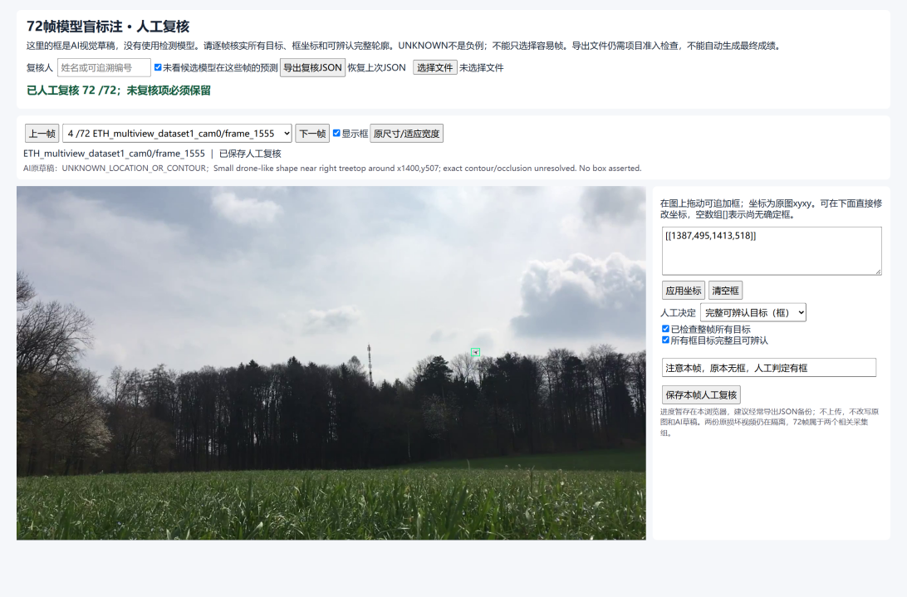
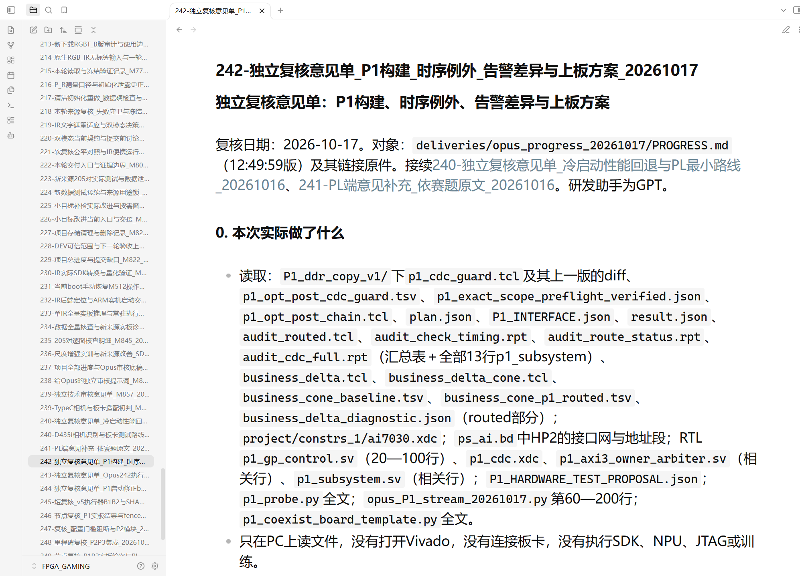
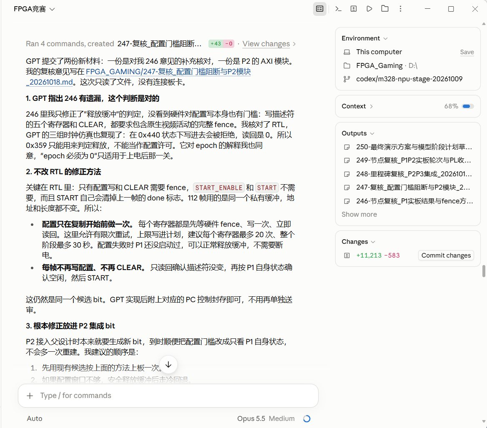
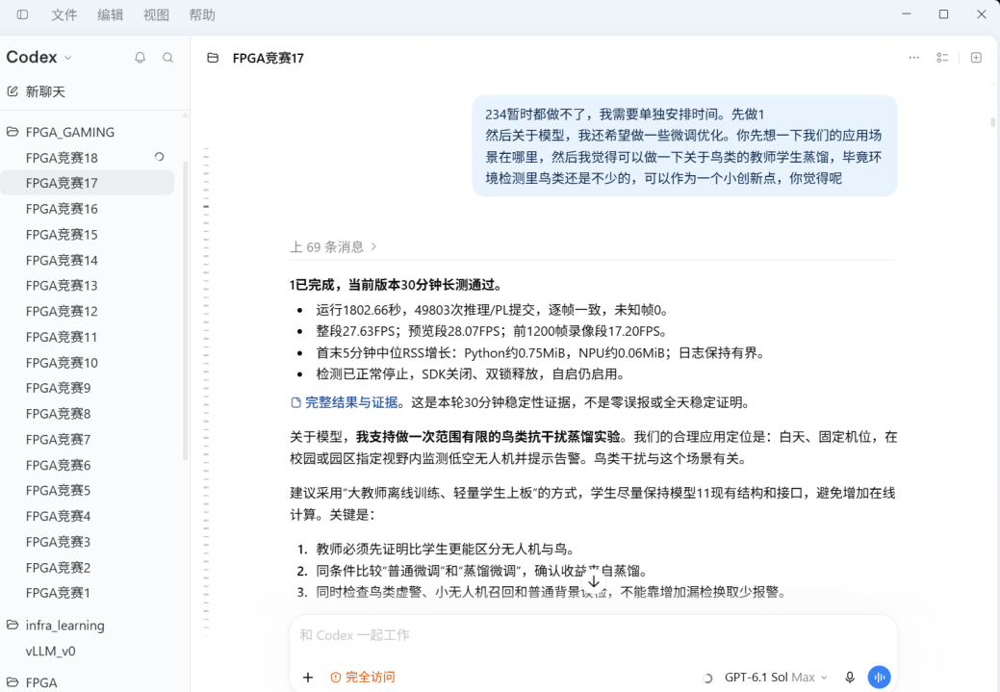
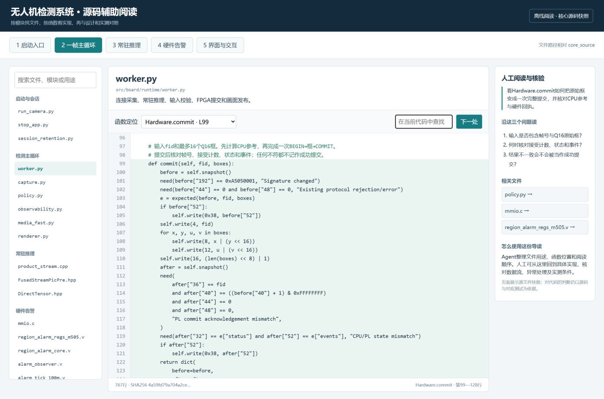

# AI 工具使用说明

本说明对应赛题的“AI 工具效率提升表现”，介绍 AI 用于方案、编码、调试和文档的环节，以及团队的人工审核、问题修正和实际成果。独立 Word《AI辅助工作说明》按图文方式介绍主要案例；本文提供更详细的分工与证据入口。

## 工具与协作方式

项目由团队提出低空无人机检测场景、确定目标和工程约束。GPT／Codex 参与方案讨论、代码与脚本实现、测试记录分析和材料整理；Opus／Claude Code 参与部分工程方案、代码和记录的独立复核。不同 Agent 通过共享仓库交接文件、问题与意见，具体模型版本以原始记录为准。

协作流程：

1. 人工提出场景、需求和约束，与 AI 讨论方案与取舍。
2. GPT／Codex 编写和修改代码、脚本或说明草稿；部分工作交由其他 Agent 独立阅读、复核，并以文件形式交接意见。
3. 人工在模型选择、数据来源与用途、代码和工程变更等节点介入，结合原图、源码、测试日志与回读核查。
4. 针对问题继续修改、测试和复核，形成作品初稿。
5. 团队完成接线、上电配合、现场飞行与操作，并检查功能、实物和提交材料后验收。

## 参与环节与工作量估计

| 环节 | AI 工具参与 | 人工占比 | AI 占比 | 主要人工工作 |
|---|---|---:|---:|---|
| 方案讨论 | 讨论方案、整理取舍 | 约 50% | 约 50% | 确定目标、场景与约束 |
| 代码与工程 | GPT／Codex 实现，Opus／Claude Code 参与复核 | 约 20% | 约 80% | 审核关键代码、工程文件与变更 |
| 人工抽样与标签判断 | Agent 提供核验页面与视觉草稿 | 约 70% | 约 30% | 看原图、检查框并保存判断 |
| 实物操作与现场验收 | Agent 辅助准备、记录与整理 | 约 90% | 约 10% | 接线、上电配合、现场操作与观察 |
| 测试分析与调试 | 编写测试脚本、整理分析记录 | 约 40% | 约 60% | 核对测试结果、异常和结论 |
| 说明材料整理 | 整理草稿、图文与索引 | 约 40% | 约 60% | 审阅修改正文、图片与最终表述 |

上述数值与技术文档一致，是团队和 Agent 对各环节内部工作量的粗略估算，并非工时统计。各环节权重不同，不能直接平均为总体比例。团队和两个 Agent 一致认为，从工作量和成品来看，AI 深度参与了项目，其总体贡献占比在 60% 以上。

## 数据来源检查与人工标签核验

数据检查中，团队审查训练集和开发集的来源、用途及重复关系，对关键验证图检查目标、修正标签并保存审核决定。公共数据集的原有标签由各数据集提供者发布；团队只将实际完成的少量标注、修框与人工核查计入自身工作。

在一次运行过程中，人工审查发现 AI Agent 执行任务期间发生了数据泄露，而工具未意识到这一问题。团队随后让 Agent 制作 HTML 文件，便于人工复查数据。

下图展示了一次 72 帧验证图核验：人工查看原图和目标轮廓，发现 AI 草稿漏掉的无人机并补充目标框，同时保存每帧的审核决定。该批基于 AI 草稿开展人工核验，未用于模型 11 训练。图片依据原页面和保存的核验结果展示。

人工反馈 HTML 页面标注区域空白后，Agent 排查发现部分草稿的框数组为空值，导致初始化异常；随后修改页面对空值的处理，同时保留原有的不确定状态。原图、草稿和人工记录未被覆盖。[匿名核验回执](06_ai-evidence/human_review_receipt.json)记录帧数与判断，[工具修正记录](06_ai-evidence/review_tool_fix.json)记录原因与核查范围。

## 工程独立复核与问题修正

### 一次 P1 候选工程复核

2026 年 10 月 17 日，独立复核围绕当时的 P1 候选工程展开。复核者读取进度材料、RTL、时序和跨时钟报告等，列出已查看和未查看的范围，并逐项写明判断、依据和后续建议。截图展示意见单的开头和文件阅读记录。

该意见指出，一组状态信号在跨时钟同步前经过组合逻辑，建议先在源时钟域寄存，再进行同步；同时提出对基线及布线后结果补充检查。后续记录继续核对修改、回归和复核结果。两份记录可按顺序阅读：

- [独立复核意见单 242](06_ai-evidence/independent_review_242.md)：对象、阅读范围、发现的问题及建议。
- [后续执行结果复核 243](06_ai-evidence/independent_review_243.md)：针对修改和验证材料继续检查，并列出仍需处理的事项。

这些材料反映当时的候选方案；建议、后续复核结论和最终作品应分别理解。

### 对复核本身的再检查

另一轮硬件配置问题讨论中，GPT 指出此前复核遗漏了配置写入的硬件门槛；Opus 对照 RTL 和既有仿真后确认遗漏，区分配置许可与释放许可，并调整控制流程建议。问题、依据与更正保留在[复核意见 247](06_ai-evidence/independent_review_247.md)及截图中。

这体现了多 Agent 交接和相互检查的具体方式：意见以可追溯文件保存，后续参与者可以继续对照源码、报告和测试记录检查，而团队据此判断取舍与验收。

## 方案讨论、代码阅读和文档审核

团队提出应用场景和鸟类干扰问题，AI 讨论教师—学生蒸馏，并建议同时查看鸟类误报、小目标召回和普通背景表现。图中展示讨论过程；方案讨论与作品已采用的功能分别表述。

[打开代码辅助阅读页面](代码辅助阅读.html)。该页面按模块、文件和函数组织阅读路径，以 `worker.py` 中的 `Hardware.commit` 为例，提示团队核对帧号、目标框提交及 CPU／FPGA 状态。页面帮助人工定位关键代码，实际判断仍需结合源码和记录。

文档独立审核提出功耗说明、开发集口径、训练素材用途和 AI 工作量等问题，团队结合实际记录审阅和修改。[文档审核意见](06_ai-evidence/document_review_251.md)保存原建议，具体取舍以最终材料为准。

## 对工作量与开发质量的作用

AI 帮助整理多来源资料、生成代码和脚本草稿、分析测试记录并准备文档。共享仓库和意见单让不同参与者能围绕同一组文件交接，人工核验与独立复核则帮助发现数据、代码和文档中的遗漏。团队通过原图审核、关键代码及工程检查、现场操作和验收决定作品方向。

项目没有统一记录使用 AI 前后的人时，故不填写总体节省工时或提效百分比。系统运行效率另有实测：同组 40 张训练图像的 SDK 前向均值由 24.36 ms 降至 11.24 ms，输出逐字节一致。这是 SDK 调度优化的运行结果，不是 AI 工作时间统计，也不计为新增 FPGA 算法加速。

## 文件与证据

- 《AI辅助工作说明》：供评审阅读的独立 Word。
- `06_ai-evidence/`：截图、匿名核验回执、工具修正记录及独立复核意见；本文图片均使用相对路径，文件夹需一起保留。
- 原始工程、测试记录及数据来源另见项目提交材料；第三方数据和工具按各自来源与许可使用。

